<!-- ============ HEADER ============ -->
<div align="center">



<a href="https://github.com/dvct1n">
  
</a>

<br/>

<a href="https://www.linkedin.com/in/nguyenductin24"></a>
<a href="mailto:nguyenductin.1410@gmail.com"></a>


</div>

---

## About Me

```python
class NguyenDucTin:
    def __init__(self):
        self.role      = "AI Engineer (fresh graduate, 2026)"
        self.education = "B.Sc. Artificial Intelligence @ FPT University HCMC"
        self.focus     = ["LLM Fine-tuning", "Agentic AI", "Multimodal RAG", "MLOps"]
        self.location  = "Ho Chi Minh City, Vietnam 🇻🇳"
        self.exchange  = "UCSI University, Kuala Lumpur 🇲🇾 (2022)"

    def current_mission(self):
        return "Building AI systems that actually ship to production."

    def open_to(self):
        return ["AI/ML Engineer", "LLM Engineer", "Agentic AI Developer"]
```

- Currently building **agentic AI** systems with LangGraph, RAG and domain-specific tools
- I like end-to-end work: **data → training → evaluation → API → deployment**
- Previously AI Developer Intern at **FPT Software** (LMS platform)
- On the side: **AI video creator** and **Software QA** freelancer
- Reach me at **nguyenductin.1410@gmail.com**

---

## Tech Stack

<table>
<tr>
<td width="210" valign="middle"><b>Languages</b></td>
<td valign="middle">&nbsp;&nbsp;</td>
</tr>
<tr>
<td width="210" valign="middle"><b>ML &amp; Deep Learning</b></td>
<td valign="middle">&nbsp;&nbsp;&nbsp;&nbsp;&nbsp;</td>
</tr>
<tr>
<td width="210" valign="middle"><b>LLM &amp; Agentic AI</b></td>
<td valign="middle">&nbsp;&nbsp;&nbsp;&nbsp;&nbsp;&nbsp;</td>
</tr>
<tr>
<td width="210" valign="middle"><b>Multimodal &amp; RAG</b></td>
<td valign="middle">&nbsp;&nbsp;&nbsp;&nbsp;&nbsp;&nbsp;&nbsp;</td>
</tr>
<tr>
<td width="210" valign="middle"><b>Backend &amp; Frameworks</b></td>
<td valign="middle">&nbsp;&nbsp;&nbsp;&nbsp;</td>
</tr>
<tr>
<td width="210" valign="middle"><b>Data &amp; MLOps</b></td>
<td valign="middle">&nbsp;&nbsp;&nbsp;&nbsp;&nbsp;&nbsp;&nbsp;&nbsp;&nbsp;&nbsp;&nbsp;</td>
</tr>
<tr>
<td width="210" valign="middle"><b>QA &amp; Testing</b></td>
<td valign="middle">&nbsp;&nbsp;&nbsp;</td>
</tr>
<tr>
<td width="210" valign="middle"><b>AI Content Creation</b></td>
<td valign="middle">&nbsp;&nbsp;&nbsp;&nbsp;&nbsp;&nbsp;</td>
</tr>
</table>

---

## Featured Projects

<table>
<tr>
<td width="50%" valign="top">

### Agentic Feng Shui Chatbot
`Jun 2026`

Multi-agent chatbot with RAG, **visual product retrieval** (SigLIP2 + OpenSearch k-NN) and deterministic Feng Shui tools (Can Chi, Nap Am, Five Elements). Benchmarked SigLIP2 vs fine-tuned **Qwen3-VL-8B** on Top-1, Recall@k and MRR.

    

</td>
<td width="50%" valign="top">

### AI Research & Data Analysis Agent
`Mar 2026`

Agent that decomposes analytical questions into multi-step workflows and picks tools dynamically: **SQL, Python analysis, web research, auto-visualization**. Outputs evidence-based reports from natural language.

   

</td>
</tr>
<tr>
<td width="50%" valign="top">

### Multimodal Document Intelligence & RAG
`Dec 2025`

Understands PDFs, scans, tables, images and charts. **Hybrid retrieval** (dense + keyword + cross-encoder reranking) with **citation-aware answers** linked to the source page.

   

</td>
<td width="50%" valign="top">

### Vietnamese Domain-Specific SLM
`Sep 2025`

Built a Vietnamese instruction dataset for customer support, then fine-tuned a compact LM with **QLoRA + SFT**. Compared against the pretrained baseline and served via a **FastAPI** inference service.

  

</td>
</tr>
<tr>
<td width="50%" valign="top">

### AI Meeting Intelligence System
`Jul 2025`

Turns long meeting recordings into searchable knowledge: **Whisper ASR, Pyannote diarization**, speaker-aware summaries, and LLM extraction of decisions, action items, owners and deadlines, with semantic search over past meetings.

   

</td>
<td width="50%" valign="top">

### Real-Time Fraud Detection & MLOps
`Mar 2025`

End-to-end pipeline for highly imbalanced transaction data. Compared **XGBoost vs LightGBM** (Precision, Recall, F1, ROC-AUC), with **MLflow** tracking, model versioning and a **Dockerized** real-time inference API.

  

</td>
</tr>
</table>

> Check out my pinned repositories below for source code and write-ups.

---

## Experience

```text
2025 ─ now   🎬 Freelancer ── AI Video Creator & Software QA Engineer
             │  Midjourney · Kling AI · Runway · ElevenLabs · CapCut
             │  Manual & automated testing in Agile-Scrum teams
             │
2024         🏢 FPT Software ── AI Developer Intern (Sep – Dec 2024)
             │  LMS features: TypeScript · Django · React · NodeJS · Python
             │
2022 ─ 2026  🎓 FPT University HCMC ── B.Sc. Artificial Intelligence
             │
2022         🌏 UCSI University, Malaysia ── English Exchange Program
```

---

## Certificates

<table>
<tr><th align="left">Issuer</th><th align="left">Certificate</th><th align="left">What I learned</th><th align="center">Link</th></tr>
<tr><td valign="middle"></td><td valign="middle"><a href="https://learn.nvidia.com/certificates?id=unQ_kreGSxuhnBqlz_3N9w"><b>Getting Started with Deep Learning</b></a></td><td valign="middle"><sub>Deep Learning fundamentals</sub></td><td align="center" valign="middle"><a href="https://learn.nvidia.com/certificates?id=unQ_kreGSxuhnBqlz_3N9w"></a></td></tr>
<tr><td valign="middle"></td><td valign="middle"><a href="https://learn.nvidia.com/certificates?id=TXV-SfCcS0-TTiyr7K2Zsw"><b>Disaster Risk Monitoring Using Satellite Imagery</b></a></td><td valign="middle"><sub>Computer Vision on satellite data</sub></td><td align="center" valign="middle"><a href="https://learn.nvidia.com/certificates?id=TXV-SfCcS0-TTiyr7K2Zsw"></a></td></tr>
<tr><td valign="middle"></td><td valign="middle"><a href="https://www.coursera.org/account/accomplishments/specialization/Y32VZE5RJ2DG"><b>AI Enterprise Workflow Specialization</b></a></td><td valign="middle"><sub>Data ingestion · Feature engineering · Model deployment · AI in production</sub></td><td align="center" valign="middle"><a href="https://www.coursera.org/account/accomplishments/specialization/Y32VZE5RJ2DG"></a></td></tr>
<tr><td valign="middle"></td><td valign="middle"><a href="https://www.coursera.org/account/accomplishments/specialization/QW98ZEFNDZFG"><b>Introduction to Machine Learning Specialization</b></a></td><td valign="middle"><sub>EDA · Regression · Classification · Unsupervised ML</sub></td><td align="center" valign="middle"><a href="https://www.coursera.org/account/accomplishments/specialization/QW98ZEFNDZFG"></a></td></tr>
<tr><td valign="middle"></td><td valign="middle"><a href="https://www.coursera.org/account/accomplishments/specialization/QLFR0186XGBL"><b>Natural Language Processing Specialization</b></a></td><td valign="middle"><sub>Classification · Probabilistic models · Sequence models · Attention</sub></td><td align="center" valign="middle"><a href="https://www.coursera.org/account/accomplishments/specialization/QLFR0186XGBL"></a></td></tr>
<tr><td valign="middle"></td><td valign="middle"><a href="https://www.coursera.org/account/accomplishments/specialization/G9TZ3P2A4N66"><b>Big Data Specialization</b></a></td><td valign="middle"><sub>Big Data modeling · Processing · ML · Graph analytics · Capstone</sub></td><td align="center" valign="middle"><a href="https://www.coursera.org/account/accomplishments/specialization/G9TZ3P2A4N66"></a></td></tr>
<tr><td valign="middle"></td><td valign="middle"><a href="https://www.coursera.org/account/accomplishments/specialization/3SQSLA8MNUT4"><b>Software Development Lifecycle Specialization</b></a></td><td valign="middle"><sub>Agile · Lean · Engineering practices</sub></td><td align="center" valign="middle"><a href="https://www.coursera.org/account/accomplishments/specialization/3SQSLA8MNUT4"></a></td></tr>
<tr><td valign="middle"></td><td valign="middle"><a href="https://www.coursera.org/account/accomplishments/specialization/AZS568W1C3JM"><b>Project Management Principles and Practices</b></a></td><td valign="middle"><sub>Planning · Budgeting · Risk and change management</sub></td><td align="center" valign="middle"><a href="https://www.coursera.org/account/accomplishments/specialization/AZS568W1C3JM"></a></td></tr>
<tr><td valign="middle"></td><td valign="middle"><a href="https://www.coursera.org/account/accomplishments/specialization/BNLD4XZ9Y4QY"><b>Ethics in the Age of AI Specialization</b></a></td><td valign="middle"><sub>Fairness &amp; bias · Privacy · Ethics in action</sub></td><td align="center" valign="middle"><a href="https://www.coursera.org/account/accomplishments/specialization/BNLD4XZ9Y4QY"></a></td></tr>
</table>

---

<div align="center">

### 🤝 Let's build something with AI together

<a href="mailto:nguyenductin.1410@gmail.com"></a>


</div>
